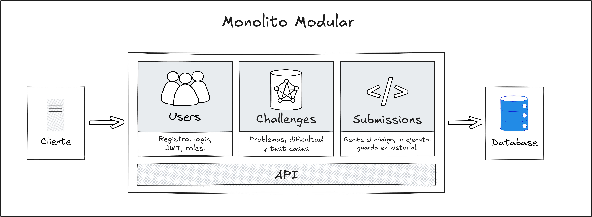

<div align="center">

# openleetcode

**Plataforma de programación competitiva construida como monolito modular con arquitectura hexagonal.**


[Arquitectura](#arquitectura) · [Modelo de datos](#modelo-de-datos) · [Estructura](#estructura-del-proyecto) · [Roadmap](#estado-del-proyecto-y-roadmap) · [Ejecución](#cómo-ejecutar-el-proyecto-localmente)

</div>

---

## Sobre el proyecto

openleetcode es una plataforma simplificada de programación competitiva inspirada en LeetCode y HackerRank. Los usuarios pueden registrarse, explorar desafíos de programación por dificultad, enviar soluciones y recibir una evaluación automática contra casos de prueba predefinidos, junto con un perfil que muestra su historial.

El objetivo no es competir con un producto comercial, sino **demostrar ingeniería de software aplicada**: código limpio, principios SOLID, límites claros entre módulos y decisiones de diseño documentadas, sin la complejidad operativa de una arquitectura de microservicios.

> El proyecto está en desarrollo activo. Las funcionalidades descritas abajo corresponden al diseño y se implementan por sprints (ver el [roadmap](#estado-del-proyecto-y-roadmap)).

## Funcionalidades previstas

| Área | Qué permite |
|---|---|
| Autenticación | Registro, inicio de sesión con JWT y autorización por rol (usuario y administrador) |
| Desafíos | Crear y consultar problemas con sus casos de prueba, filtrados por dificultad |
| Envíos | Enviar código, evaluarlo automáticamente y obtener un veredicto |
| Perfil | Historial de envíos y estadísticas de problemas resueltos |

---

## Arquitectura

### Monolito modular

La aplicación es una **única unidad desplegable** (un proceso, una base de datos) organizada en tres módulos con límites estrictos:

| Módulo | Responsabilidad |
|---|---|
| `auth` | Registro, login, JWT y roles |
| `challenges` | Desafíos, casos de prueba y dificultades |
| `submissions` | Recepción de código, evaluación, veredictos, historial y estadísticas del perfil |




Reglas que mantienen la modularidad:

1. Cada módulo es dueño de sus tablas. Entre módulos solo se referencia por ID, sin claves foráneas cruzadas.
2. Los módulos se comunican únicamente a través de la interfaz pública de la capa application (sus puertos de entrada), nunca accediendo a clases internas de otro módulo.
3. Dentro de cada módulo, las dependencias apuntan hacia adentro: `infrastructure` depende de `application`, y `application` depende de `domain`.
4. Estas reglas se verifican automáticamente con un test de arquitectura.


### Arquitectura hexagonal por módulo

Cada módulo es una pequeña aplicación hexagonal con tres capas:

| Capa | Contenido | Depende de |
|---|---|---|
| `domain` | Entidades, objetos de valor y reglas de negocio | Nada |
| `application` | Casos de uso y puertos (de entrada y de salida) | `domain` |
| `infrastructure` | Adaptadores de entrada (REST) y de salida (base de datos, JWT, Docker) | `application` |

El dominio no conoce frameworks ni tecnologías. Los detalles técnicos se conectan a través de puertos, lo que permite probar la lógica de negocio con implementaciones en memoria y sustituir adaptadores sin tocar el núcleo.

### Evaluación de código

La ejecución de código ajeno es la parte más delicada del sistema. Se aísla detrás de un puerto de salida, de modo que el dominio no sabe que existe Docker:


Los casos de prueba son datos (pares de entrada y salida esperada en texto), no código, y los programas leen de la entrada estándar y escriben en la salida estándar. Esto vuelve la evaluación independiente del lenguaje.

Cada ejecución corre en un contenedor descartable, sin red y con límites de memoria, CPU, procesos y tiempo.

### Principios SOLID aplicados

| Principio | Cómo se aplica |
|---|---|
| Responsabilidad única | Un caso de uso por clase |
| Abierto/cerrado | Nuevos lenguajes y estrategias de veredicto se agregan sin modificar código existente |
| Sustitución de Liskov | Cualquier implementación de un puerto (ejecutor, repositorio) es intercambiable |
| Segregación de interfaces | Puertos pequeños y específicos |
| Inversión de dependencias | Dominio y aplicación dependen de abstracciones, la infraestructura las implementa |

---

## Modelo de datos

Una única base PostgreSQL con cuatro entidades y tablas de catálogo para valores fijos (roles, dificultades, lenguajes y veredictos). El esquema se versiona con migraciones.


---

## Estructura del proyecto

```
src/main/java/com/santiagolovisotto/openleetcode/
├── modules/
│   ├── auth/
│   │   ├── domain/
│   │   ├── application/
│   │   └── infrastructure/
│   │       ├── inbound/       (REST, DTOs)
│   │       └── outbound/      (persistencia, JWT, hashing)
│   ├── challenges/            (misma estructura)
│   └── submissions/           (misma estructura)
├── shared/                    (solo lo que usan al menos dos módulos)
└── OpenLeetcodeApplication.java
```

---

## Tecnologías y herramientas

| Categoría | Herramienta |
|---|---|
| Lenguaje | Java 21 |
| Framework | Spring Boot 4.1.2 |
| Build | Gradle |
| Persistencia | PostgreSQL y Spring Data JPA |
| Migraciones | Flyway |
| Ejecución aislada | Docker |
| Pruebas | JUnit, Testcontainers y test de arquitectura |
| CI | GitHub Actions |

---

## Documentación detallada

* [Primeros pasos con Scrum](./docs/planning/scrum.md)
* Guía de arquitectura: `[Falta implementar]`
* Decisiones de diseño (ADRs): `[Falta implementar]`

---

## Cómo ejecutar el proyecto localmente

Requisitos previos:

* Java 21
* Docker

Las instrucciones completas (base de datos con Docker Compose y arranque de la aplicación) se documentarán al completar el Sprint 0.

---

## Estado del proyecto y roadmap

Plan de trabajo en sprints (Scrum individual). Cada sprint entrega algo que funciona de punta a punta, siguiendo el orden de dependencias entre módulos: `auth` → `challenges` → `submissions`.

Tablero completo en Trello: https://trello.com/b/UNYvKcef

**Progreso general:** 4 de 28 tareas completadas.


| Sprint | Objetivo | Progreso |
|---|---|---|
| S0 | Fundaciones | 4/6 |
| S1 | Módulo `auth` | 0/5 |
| S2 | Módulo `challenges` | 0/5 |
| S3 | Módulo `submissions` con ejecutor falso | 0/5 |
| S4 | Ejecutor Docker real | 0/3 |
| S5 | Pulido y documentación | 0/4 |

## Sprint 0: Fundaciones

Esqueleto del proyecto, base de datos con Docker Compose, migraciones, test de arquitectura y CI.

- [x] Esqueleto del proyecto y estructura de módulos (auth, challenges, submissions, shared)
- [x] Docker Compose con PostgreSQL
- [x] Migraciones configuradas (Flyway) con migración inicial
- [x] Test de arquitectura que verifique límites entre módulos y capas
- [ ] CI con GitHub Actions (build + tests)
- [ ] Endpoint de salud y README inicial

## Sprint 1: Módulo `auth`

Registro, login con JWT y autorización por rol.

- [ ] Migración: tablas role y users + datos de roles
- [ ] Registrar usuario (dominio + caso de uso + tests con repositorio en memoria)
- [ ] Iniciar sesión y emitir JWT
- [ ] Adaptadores de auth: persistencia de usuarios y endpoints REST
- [ ] Autorización por rol (user / admin)

## Sprint 2: Módulo `challenges`

Problemas con sus test cases, listado con filtro por dificultad y API pública para otros módulos.

- [ ] Migración: difficulty, challenges y test_cases + datos de dificultades
- [ ] Crear challenge con sus test cases (solo admin)
- [ ] Listar y ver challenges (filtro por dificultad)
- [ ] Adaptadores de challenges: persistencia y endpoints REST
- [ ] API pública de challenges para que submissions obtenga test cases por ID

## Sprint 3: Módulo `submissions` con ejecutor falso

Enviar soluciones, calcular el veredicto, guardar el historial y mostrar estadísticas del perfil.

- [ ] Migración: language, verdict y submissions + datos de catálogos
- [ ] Enviar solución con ejecutor falso (puerto + caso de uso + tests)
- [ ] Comparar salida y calcular veredicto (corta en el primer fallo)
- [ ] Adaptadores de submissions: persistencia, REST y adaptador hacia challenges
- [ ] Historial de submissions y estadísticas del perfil

## Sprint 4: Ejecutor Docker real

Ejecución aislada de código Python, manejo de errores y tests de integración.

- [ ] Ejecutor Docker para Python: contenedor descartable sin red y con límites
- [ ] Manejo de timeout, runtime error y compilation error
- [ ] Tests de integración con Testcontainers (Postgres + ejecutor real)

## Sprint 5: Pulido y documentación

Datos de ejemplo, OpenAPI, README con diagramas y ADRs.

- [ ] Challenges de ejemplo cargados por migración
- [ ] Documentación OpenAPI / Swagger
- [ ] README con diagramas de arquitectura, módulos y entidades
- [ ] ADRs: monolito modular, ejecutor como puerto, migraciones y límites sandbox


---

## Licencia

Este proyecto se distribuye bajo la licencia **GNU General Public License v3.0 (GPL-3.0)**.